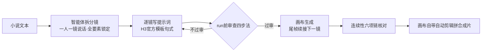

# yuh-h3-prompt-skill · YUH 画布全自动做剧提示词技能（选装）

> 一套跑在 [YUH Studio](https://www.yuh.ai/) 画布 + MiniMax H3 视频模型上的**提示词技能**：覆盖「小说 → 分镜 → 提示词 → 审查 → 生成 → 拼片」全链路的创作规范与避坑手册。
>
> **它解决一个问题**：单镜头看惊艳，整片接不上——光线跳变、道具漂移、造型崩坏、台词时间轴失控。这些都是我们和外部创作者真金白银烧出来的坑，本技能把它们变成可执行规则。
>
> **不只是文档**：`mcp/` 目录内含即用型 MCP server（36 个工具），其中 `yuh_drama_skill` 工具直接吐出本技能全文——提示词技能与画布操作能力融合成一个 server，智能体装一个 MCP 就是「技能 + 手」全套。

[](LICENSE)


---

## 目录

- [这是什么](#一这是什么)
- [背景：它跑在什么环境上](#二背景它跑在什么环境上)
- [设计原则：零侵入选装](#三设计原则零侵入选装)
- [技能内容总览（四部分）](#四技能内容总览四部分)
- [快速上手](#五快速上手)
- [技术方案](#六技术方案)
- [避坑报告](#七避坑报告)
- [文件结构](#八文件结构)
- [适用范围与已知局限](#九适用范围与已知局限)
- [贡献与反馈](#十贡献与反馈)
- [License](#license)

---

## 一、这是什么

YUH Studio 的画布助手（社区昵称「小黑」）自带出厂技能，负责全自动做剧。本仓库把实战验证过的做剧经验整理成**一个独立的自定义技能**，通过画布自带的「添加 Skill」功能加入。

一句话概括它管什么：

| 环节 | 它管的事 |
|---|---|
| 小说 → 分镜 | 一镜只一人开口、正反打切镜、场景色温/造型/道具/布局全部锁定 |
| 提示词撰写 | 套 H3 官方模板句式：说话人 ID、台词时间窗、活尾估算、禁空泛词 |
| run 之前 | 四步审查：常理逻辑 → 道具特意约束 → 模板合规 → 连续性六项链 |
| 生成之中 | 尾帧续接三步法、run 假失败辨别（不双跑） |
| 成片收尾 | 画布自带自动剪辑通道拼接（不用 ffmpeg 手拼） |

## 二、背景：它跑在什么环境上

- **YUH Studio**：本地化的 AI 做剧应用，画布上摆「人物三视图 / 场景 / 音色」素材节点，连线后由画布助手（小黑）自动生成视频
- **MiniMax H3**：画布调用的视频生成模型，单镜 6-8 秒，擅长单人物表演，弱项见 [技术方案第四章](docs/TECHNICAL.md#四h3-能力边界与机理避坑十条逐条拆解)
- **典型翻车现象**（都有真实翻车实例）：

| 翻车 | 实例 |
|---|---|
| 光线跳变 | 上一镜深夜冷光，下一镜没理由变暖黄日光 |
| 道具漂移 | 前镜圆桌后镜方桌；纸箱没写引入凭空出现 |
| 造型漂移 | 每镜换个说法描述服装，AI 每次自由发挥 |
| 台词失控 | 开口时刻 0-6 秒随机，镜头结束时话没说完 |
| 多人同框崩 | 口型只对一个说话人，其他人嘴乱动 |

## 三、设计原则：零侵入选装

| 原则 | 说明 |
|---|---|
| **出厂不动** | 出厂技能库、助手记忆文件，一个字不改 |
| **只增不改** | 经验全部装在这一个选装技能里，与出厂技能并存 |
| **选装调用** | 用时在技能下拉里勾选才生效；不用时完全不参与 |
| **随时可退** | 不想要了删掉即可，出厂从未被碰过 |

## 四、技能内容总览（四部分）

技能名：**《全自动做剧·流程审查与避坑手册（选装）》**，全文见 [`skill/yuh-drama-prompt-skill.md`](skill/yuh-drama-prompt-skill.md)。

| 部分 | 内容 | 条数 |
|---|---|---|
| 一·标准流程 | 出厂已验证流程原样继承：三件套输入、音色先出 wav、尾帧续接三步法、改词传 prompt 字段、run 假失败处理、画布自带拼接 | 7 条 |
| 二·小说→分镜创作规范 | 一镜只一人开口+正反打切镜、场景色温光源逐场景锁定、造型规范英文逐字照抄、道具登记表+引入镜头、场景布局锁定、镜头时长按台词字数估算、分镜落强项 | 7 条 |
| 三·run 前审查四步法 | ①常理/逻辑 ②道具特意约束 ③H3 官方模板合规 ④连续性六项链 | 4 步 |
| 四·H3 局限避坑 | 外部 35-40 小时实测复盘：能力区窄、光最大变量、道具自由发挥、台词时间轴失控、复读、文字比参考图当真、尾帧取干净帧、帧数格子、红灯真停、一场戏为排产单位 | 10 条 |

## 五、快速上手

### 1. 装进画布

复制 [`skill/yuh-drama-prompt-skill.md`](skill/yuh-drama-prompt-skill.md) 中「技能正文」整段（从 `【定位】` 开始），粘贴到 YUH Studio 画布的 **技能管理 → 添加 Skill** 的 instructions 里，技能名填：

```
全自动做剧·流程审查与避坑手册（选装）
```

### 2. 用

- 日常简单任务：不勾选，走出厂流程
- **小说改编多镜连续剧**（有道具/光线/台词/服装连续性要求）：在技能下拉里勾选本技能

### 3. 更新

改了技能内容后同名覆盖：画布技能管理里编辑粘贴全文保存，或让画布助手调用 save_skill 同名覆盖。

### 4. 装画布 MCP（让智能体直接操作画布）

`mcp/` 目录是即用型 MCP server（Python 3.10+，依赖 `mcp httpx pydantic`）：

```powershell
cd mcp
python -m venv .venv
.venv\Scripts\pip install mcp httpx pydantic -i https://pypi.tuna.tsinghua.edu.cn/simple
```

智能体 MCP 配置（Trae CN 写 `%APPDATA%\Trae CN\User\mcp.json`，WorkBuddy 写 `%USERPROFILE%\.codebuddy\mcp.json`）：

```json
"yuh": {
  "command": "<部署目录>\\mcp\\.venv\\Scripts\\python.exe",
  "args": ["-X", "utf8", "<部署目录>\\mcp\\server.py"]
}
```

装好后的关键工具：

| 工具 | 作用 |
|---|---|
| `yuh_drama_skill` | 取本技能全文（写多镜连续剧提示词前必调） |
| `yuh_canvas_enable` / `yuh_canvas_list` / `yuh_canvas_add` / `yuh_canvas_update` / `yuh_canvas_run` | 画布 SOP 与节点链路 |
| `yuh_canvas_extract_frame` | 抽帧（尾帧续接用） |
| `yuh_studio_call('utilities:merge-videos', ...)` | 画布自带自动剪辑拼合 |
| `yuh_status` / `yuh_env_check` | 连接与环境体检 |

**画布类工具需要 YUH Studio 桌面端保持运行**（MCP 自动探测其端口连接）；`yuh_drama_skill` 不依赖画布，没有 YUH Studio 的机器也能取技能写提示词。

## 六、技术方案

完整技术方案（管线架构图、分层可控理念、六阶段详解、H3 机理分析、实战案例）见：

**[`docs/TECHNICAL.md`](docs/TECHNICAL.md)**

核心思路一图流：



三句话讲完理念：

1. **规则框架用内置规范**（画布出厂流程 + H3 官方模板），大方向不动
2. **提示词文笔交给 AI**，但必须套在官方模板里，且道具/光线/造型全部显式写死
3. **run 之前必须过审**，审查不过先改词再审——机器不能自判无误

## 七、避坑报告

B 站视频《单镜头很惊艳，整集却接不上？本地 H3 做 AI 长片的踩坑复盘》（UP 主：小乐实验室）的深度整理：

- 原片 850 秒全文转写 + 12 帧画面采样 → 图文报告 [`report/h3-longfilm-pitfalls-v2.html`](report/h3-longfilm-pitfalls-v2.html)
- 自包含 HTML，双击即看，含 9 张原片截图、完整账本与三级预警体系

## 八、文件结构

```
yuh-h3-prompt-skill/
├── README.md                          ← 本文件
├── LICENSE                            ← MIT
├── docs/
│   └── TECHNICAL.md                   ← 技术方案（管线架构/六阶段详解/机理分析/实战案例）
├── skill/
│   └── yuh-drama-prompt-skill.md      ← 技能全文（装进画布时整段复制）
├── mcp/
│   ├── server.py                      ← YUH 画布 MCP server（36 工具，含 yuh_drama_skill）
│   ├── drama_skill.md                 ← server 内置技能文件（与 skill/ 同源）
│   └── test_smoke.py                  ← 冒烟测试
└── report/
    └── h3-longfilm-pitfalls-v2.html   ← 避坑图文报告（自包含双击即看）
```

## 九、适用范围与已知局限

**适用**：YUH Studio 画布 + MiniMax H3 的全自动做剧工作流，尤其是小说改编多镜连续剧。

**已知局限（诚实声明）**：

- 本技能是**经验规则集**，不是程序——最终效果依赖画布版本与 H3 模型行为，模型升级后部分参数（如帧数格子）可能变化
- 提示词规则针对中文台词创作（`<d>[Chinese]台词</d>` 句式），其他语言需自行调整时间窗估算（4-5 字/秒）
- 多人同框、复杂打斗是 H3 模型级弱项，规则只能规避不能根治
- 「帧数格子」「run 假失败超时阈值」等数值来自当前版本实测，仅供参照

## 十、贡献与反馈

- 发现新坑/新规避方法：欢迎 Issue / PR，或直接在文档基础上增补
- 技能内容更新约定：改 [`skill/yuh-drama-prompt-skill.md`](skill/yuh-drama-prompt-skill.md) → 同名覆盖画布技能 → 同步双仓
- 实战数据（时长/翻车率等）欢迎附带复现环境说明提交

## 致谢

- [小乐实验室](https://space.bilibili.com/) —— H3 长片踩坑复盘视频提供了 35-40 小时的实测账本（第四部分避坑的主要来源）
- 所有在实战中帮我们把坑踩平的画布用户

## 双仓互备

| 远程 | 地址 | 用途 |
|---|---|---|
| GitHub | https://github.com/liuyanjunjsj/yuh-h3-prompt-skill | 主仓 |
| CNB（腾讯云） | https://cnb.cool/liuyanjunjsj/yuh-h3-prompt-skill | 备份 + 网页端随手改 |

两仓内容完全一致，任一处网页可改。

## License

[MIT](LICENSE) © 2026 liuyanjunjsj
