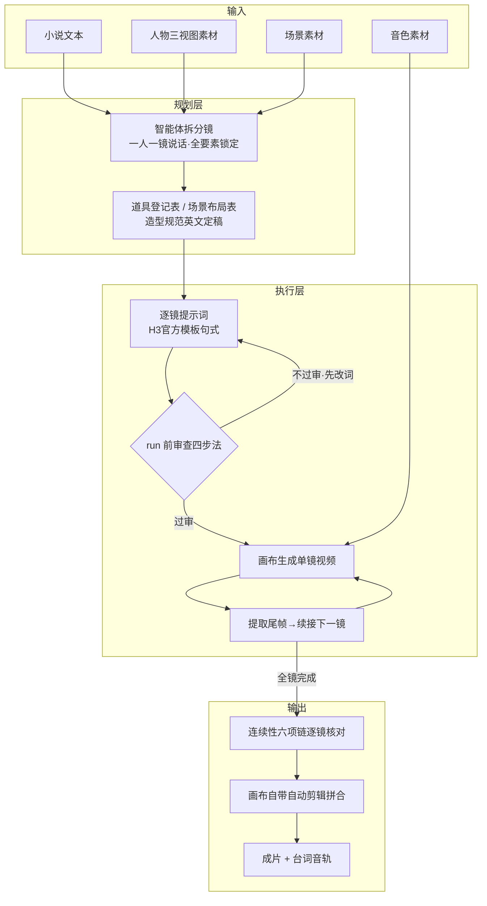

# 技术方案：YUH 画布 × MiniMax H3 可控做剧管线

> 本文是本仓库的技术方案总纲：讲清楚这套「小说 → 成片」管线是怎么搭的、每一步为什么这么设计、坑在哪、怎么躲。
>
> 读者假设：你用过或打算用 YUH Studio 画布做剧；不需要任何编程背景。

## 目录

- [一、总体架构](#一总体架构)
- [二、核心理念：分层可控，不做全自由生成](#二核心理念分层可控不做全自由生成)
- [三、全链路六阶段详解](#三全链路六阶段详解)
  - [阶段 0：输入三件套](#阶段-0输入三件套)
  - [阶段 1：小说 → 分镜](#阶段-1小说--分镜)
  - [阶段 2：逐镜提示词工程](#阶段-2逐镜提示词工程)
  - [阶段 3：run 前审查四步法](#阶段-3run-前审查四步法)
  - [阶段 4：生成与逐镜续接](#阶段-4生成与逐镜续接)
  - [阶段 5：拼合输出](#阶段-5拼合输出)
- [四、H3 能力边界与机理（避坑十条逐条拆解）](#四h3-能力边界与机理避坑十条逐条拆解)
- [五、实战案例：《忘记一个人》](#五实战案例忘记一个人)
- [六、工程坑台账](#六工程坑台账)
- [七、局限与展望](#七局限与展望)

---

## 一、总体架构

### 1.1 全流程管线



### 1.2 分层责任划分

这套管线把「谁负责什么」划得很清楚，避免职责混在一起互相污染：

| 层 | 负责内容 | 谁 |
|---|---|---|
| 流程框架层 | 节点类型、连线方式、run 顺序、校验规则 | 画布出厂流程 + H3 官方模板（**不动**） |
| 内容文笔层 | 具体每镜的画面描述、台词措辞 | AI（智能体）自由发挥，**但必须套在官方模板里** |
| 质量守门层 | 逻辑、道具、模板合规、连续性 | 审查四步法（**run 之前强制过审**） |
| 经验沉淀层 | 坑与对策 | 本技能（选装，用时勾选） |

一句话：**框架不写死文笔，文笔不越框架，机器不自判无误。**

## 二、核心理念：分层可控，不做全自由生成

把一段小说直接丢给模型「自由生成一集」，得到的通常是：光线随剧情心境乱跳、道具凭空出现消失、角色服装每镜不一样、口型对不上说话人。这不是模型不够强，而是**你没给它约束，它就按概率自由发挥**。

所以整套方案建立在三个反直觉但实测有效的原则上：

1. **画面内容靠文字锁死，不靠参考图。** H3 对提示词文字的服从度高于参考图——同一角色一处英文描述写反了，错误会跟着模板复制到后面每一镜。所以造型、道具、光线都要变成「固定英文描述、每镜逐字照抄」。
2. **把弱项从分镜源头绕开，而不是靠提示词硬拗。** 多人同框、打斗、暖黄光人脸是模型级弱项，提示词写得再好也救不回来。解法在分镜阶段：一镜只一人开口、正反打切镜、群戏拆单人反应镜。
3. **机器不能自判无误。** 自动流程报错/红灯必须停下人工核实再续跑，禁止自动清错后继续跑。外部实测这么干废品率 62%。

## 三、全链路六阶段详解

### 阶段 0：输入三件套

| 素材 | 要求 | 为什么 |
|---|---|---|
| 人物三视图 | 每个主要角色一套（正/侧/背） | 视频节点连角色线时按此锁定长相 |
| 场景素材 | 每个场景一张 | 锁定环境基调 |
| 音色素材 | 每个开口角色一条 | **必须先 run 出 wav**，视频节点 prompt 里引用 `<Audio N>` 才能过软件校验（否则报「需要 N 个独立音色参考，当前只连入 0 个」） |

两条纪律：

- 禁止生成多余的独立音频文件——台词直接作为视频音轨输出，不做独立旁白
- 视频风格全片统一 2.5D 动漫，在分镜阶段定死，之后每镜照抄

### 阶段 1：小说 → 分镜

输入是小说时，智能体要做「导演 + 场记」两件事，产出分镜脚本。七条创作规范：

**1. 一镜只一个角色开口。**
H3 口型只能对一个说话人，多人同框时其他角色嘴会乱动。需要对话就切镜——正反打：A 说完的单人镜 → B 回应的单人镜。确需多人同框，只做静态群像不安排台词，且提示词必须写明其他角色闭唇静止。

**2. 场景色温/光源逐场景锁定。**
分镜阶段为每个场景写死「时段 + 光源 + 色温」，例如：

```
深夜室内、唯一光源为桌上油灯、暖黄侧逆光、全片该场景光线不变
```

之后每镜提示词照抄。禁止随剧情心境乱改光线——冷暖跳变是最常见的穿帮。

**3. 风格与造型锁定。**
每个角色的造型规范（服装/发型/年龄感）分镜阶段定稿成**一段固定英文描述**，每镜逐字照抄。为什么这么死板：模型看文字比看参考图更当真，每镜换个说法 = 造型每镜自由发挥 = 漂移。

**4. 道具登记表。**
分镜阶段列出全片道具清单，每个道具写死：形状 / 材质 / 颜色 / 数量 / 状态。每镜用到的道具**照表描述**。新道具首次出现必须有引入镜头（先「把照片放进纸箱」，后「抱着纸箱」）——不给引入镜头，道具就是凭空出现的穿帮。

**5. 场景布局锁定。**
场景内家具/陈设/方位写死：桌是圆是方、门朝哪开、窗在哪。每镜照抄，禁止即兴。实测翻车案例：前镜圆桌后镜方桌。

**6. 镜头时长不拍脑袋。**
估算公式：

```
镜头时长 ≈ 台词字数 ÷ 4~5字/秒 + 开口缓冲 + ≥1.3秒活尾
```

宁长勿短。另注意「帧数格子」：填 6 秒实际输出 6.58 秒、填 7 秒给 7.29 秒（可用帧数有格子、向上取整），**时间轴按实际输出秒数排，不按填写秒数**。

**7. 分镜尽量落强项。**
强项：一人独处、冷调侧光、一句台词、固定机位、物件特写。群戏、打斗改成切单人反应镜或物件特写镜来叙事。一场戏 3-12 个镜头由内容决定——每镜等长 + 每镜一句台词 = 预告片语法，不像正片。

### 阶段 2：逐镜提示词工程

每镜提示词按 H3 官方模板三段式写，句式逐条对齐官方规范：

**结构（三段式）：**

```
[Continuity anchor 英文句，置顶——承接上镜末态]
[时间轴正文：英文画面描述，含台词标记]
overall_soundscape: [环境音，多镜统一]
non_diegetic_music: N/A
```

**台词官方句式：**

```
对白：   角色名 (S1) says: <d>[Chinese]台词</d>
画外音： <Audio N> 角色名 (S2) says in an off-screen voiceover: <d>[Chinese]台词</d> while her lips remain completely closed.
```

要点：

- 说话人 ID（S1/S2/…）**全片一致**，一个角色从头到尾同一个编号
- 画外音固定短语 `off-screen voiceover` + `lips remain completely closed`（物理锁死闭嘴）
- 中文台词用 `<d>[Chinese]…</d>` 标记，按 4-5 字/秒给足窗口
- 正文全英文不夹中文（台词标记除外）；禁空泛词（cinematic / beautiful 这类词模型没法执行）

**规则框架 vs 文笔的分工**：句式、编号、标记、结构全部按官方模板来，一个字不改；画面描述的文笔由 AI 写，但道具/光线/造型的每个具体特征必须从阶段 1 的登记表里照抄，不允许即兴。

### 阶段 3：run 前审查四步法

每镜提示词在 run 之前必须过四道审查，**不过审先改词再审，禁止直接 run**。这是整个管线质量守门的核心。

| 步骤 | 查什么 | 典型不通过 |
|---|---|---|
| ① 常理/逻辑审查 | 画面符合物理常识与剧情逻辑 | 雨夜有月光；关灯后凭空来光；道具凭空出现/消失/变形；同一人同时在两地 |
| ② 道具特意约束审查 | 可交互道具显式写死形状/材质/颜色/数量/状态 | 只写泛称（a table / a box）——模型必自由发挥，实测圆桌方桌翻车 |
| ③ H3 官方模板合规审查 | 三段式完整；`<Picture N>`/`<Audio N>` 编号与画布连线顺序逐一对应；台词句式合规；说话人 ID 全片一致；4-5 字/秒窗口；正文全英文；Continuity anchor 置顶；无空泛词 | 编号对不上连线、ID 前后不一致、台词窗口太短 |
| ④ 连续性六项链 | 时间光线链 / 道具链 / 场景家具形状链 / 服装链 / 人数站位链 / 动作承接链（下镜起始态=上镜末态）；多镜 soundscape 统一 | 上一镜箱子在桌上这一镜抱怀里；上镜雨夜这镜天晴 |

其中第④步的「动作承接链」最容易被忽略：下一镜的开头状态必须等于上一镜的结尾状态（手里有没有东西、人站坐、门开关），尾帧续接（阶段 4）解决画面层，提示词里的 Continuity anchor 解决语义层，两层都要有。

### 阶段 4：生成与逐镜续接

**音色先行**：音色素材节点必须先 run 出 wav，视频节点才能引用。

**尾帧续接三步法**（多镜保持画面连续的实测稳定做法）：

```
1. 上镜 run 完 → 提取尾帧（单独一批发）
2. 从画布工程文件定位新节点位置
3. 断开下镜全部图片线 → 单发连接尾帧 → 批量补角色线 → run
```

取尾帧**别取最后一帧**——末尾常已漂移，往前退几帧取干净帧。

**run 假失败辨别**：单镜生成约 10 分钟后 MCP 层报 REQUEST_TIMEOUT，多数是**假失败**——任务实际已在跑。正确动作：查任务列表找最新任务 id，等待其完成。**禁止盲目重跑**（会双跑，浪费 10 分钟级时长还占显存）。

### 阶段 5：拼合输出

多镜成片**必须走画布自带的自动剪辑通道**拼接（调用画布内置的 merge-videos 工具，按镜序传 mp4 绝对路径，transition 用 none 保持硬切），拼完在画布上建「拼合预览（N 段）」视频节点并把 N 个分镜节点连进去。

**禁止用 ffmpeg 自行拼接**——会绕过画布的产物管理，且丢失后续在画布内继续编辑的可能。

---

## 四、H3 能力边界与机理（避坑十条逐条拆解）

来源：B 站 UP 主「小乐实验室」35-40 小时全本地生成 11 分 19 秒古装剧的实测复盘（详见[避坑报告](../report/h3-longfilm-pitfalls-v2.html)）+ 本项目实战验证。每条按「现象 → 机理 → 对策」拆：

| # | 现象 | 机理 | 对策 |
|---|---|---|---|
| 1 | 能力区窄：多人同框、打斗、暖黄光人脸、易变形小道具全崩 | 模型训练分布集中在单人表演场景 | 分镜落强项；避不开用审查死守 |
| 2 | 光线是最大变量，同一场景前后镜光线跳变 | 光线是生成自由度最大的维度，不写死就每镜重抽 | 人脸镜头冷调侧光（明暗轮廓反差大，放大后才有细节可依）；必须暖光时主光压成侧逆光靠轮廓制造反差；同场景全片光线一致 |
| 3 | 道具被自由发挥（半块玉佩画成一团红） | 泛称给了模型完整解释权 | 所有道具特征写死，特写镜头尤其要写 |
| 4 | 台词时间轴不可控：开口 0-6 秒随机、语速 1-6 字/秒波动 | 模型对音频时间轴没有精确控制 | 台词按 4-5 字/秒给足窗口；提示词写明「说完至少留 1.3 秒再结束（活尾）」；不把镜头时长卡死 |
| 5 | 台词复读（「没有敲门」念成「没有敲门，没有敲门也没有回答」） | 长否定句的语义转折被模型当补全 | 台词简短明确，避免长否定句 |
| 6 | 文字比参考图更被当真 | 提示词权重高于图像参考 | 提示词与造型规范完全一致，禁止双源矛盾；一处写反，错误跟模板复制到每一镜 |
| 7 | 尾帧接尾帧出现漂移累积 | 末帧常含模型收尾漂移 | 往前退几帧取干净帧 |
| 8 | 填 6 秒输出 6.58 秒 | 可用帧数有格子、向上取整 | 时间轴按实际输出秒数排 |
| 9 | 自动清错继续跑 → 废品率 62% | 机器不能自判无误 | 报错/红灯必须停下人工核实再续跑 |
| 10 | 每镜等长成片像预告片 | 预告片语法（等长 + 每镜一句词） | 排产单位是一场戏（3-12 镜由内容决定），不等长 |

## 五、实战案例：《忘记一个人》

本项目 4 镜连续剧的翻车与修复台账，作为审查四步法的实证：

### v1 翻车

| 翻车点 | 违反的规则 |
|---|---|
| 光线链断裂：镜 1 雨夜冷光 → 镜 2 无理由变暖黄 | 审查① + 六项链之时间光线链 |
| 纸箱凭空出现：镜 2 角色直接「抱着纸箱」，前文无引入 | 审查① + 分镜规范 4（道具引入镜头） |
| 圆桌变方桌：前后镜家具形状不一致 | 审查② + 分镜规范 5（布局锁定） |

### v2 修复

- 统一全片为同一雨夜：每镜 Continuity anchor 写明「持续雨声、油灯暖光、深夜室内」
- 纸箱加引入镜头：先「把照片放进纸箱」再「抱着纸箱」，道具登记表登记形状/材质/颜色
- 台词全部不动，只改画面描述——**审查修的是画面逻辑，不是剧情**

### 结论

4 镜串行重跑 + 画布自带拼接，v2 成片连续性达标。成本：4 次重跑约 40 分钟级 GPU 时长。教训价值：**run 前审查十分钟，省掉 run 后重跑一小时**。

## 六、工程坑台账

画布工程层面的坑，与提示词无关但同样致命：

| 坑 | 现象 | 正确姿势 |
|---|---|---|
| 字段静默丢弃 | 用 canvas_update 改节点提示词传 `text` 字段，被 Pydantic 静默丢弃不报错，run 后发现还是旧词 | **必须传 `prompt` 字段** |
| run 假失败 | canvas_run 约 10 分钟报 REQUEST_TIMEOUT 但任务实际已在跑 | list_tasks 找最新任务 id → task_wait 等结果，禁止盲目重跑 |
| 音色校验 | 视频节点引用 `<Audio N>` 但音色节点没 run，报「需要 N 个独立音色参考，当前只连入 0 个」 | 音色素材节点先 run 出 wav |
| 拼接通道 | ffmpeg 手拼绕过画布产物管理 | 走画布内置 merge-videos，transition 用 none |
| 尾帧定位 | extract_frame 返回的帧 id 需对照工程文件定位节点 idx | 提取尾帧单独一批发，返回后按 id 定位再连线 |

## 七、局限与展望

**当前局限**：

- 本技能是经验规则集，不是程序——最终效果依赖画布版本与 H3 模型行为，模型升级后部分参数（帧数格子、超时阈值）需重新实测
- 规则面向中文台词创作，其他语言需自行调整时间窗估算
- 多人同框、复杂打斗是模型级弱项，规则只能规避不能根治

**可探索方向**：

- 审查四步法的自动化：把四步审查做成脚本预检（模板合规、编号一致性、台词字数/秒比可程序化验证；常理逻辑审查仍需语义理解）
- 道具登记表结构化：JSON 台账 + 自动注入每镜提示词，替代人工照抄
- 连续性六项链自动核对：相邻两镜的 anchor 句 diff 检查
- 多语言台词支持与时间窗自适应
